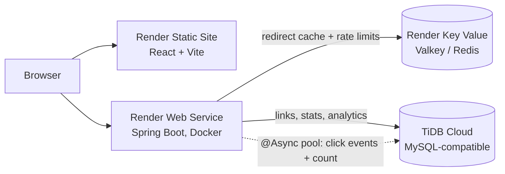
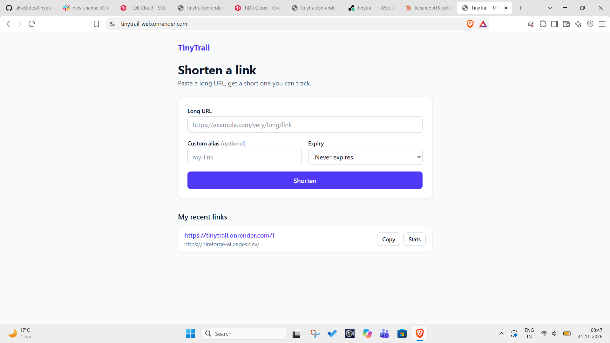
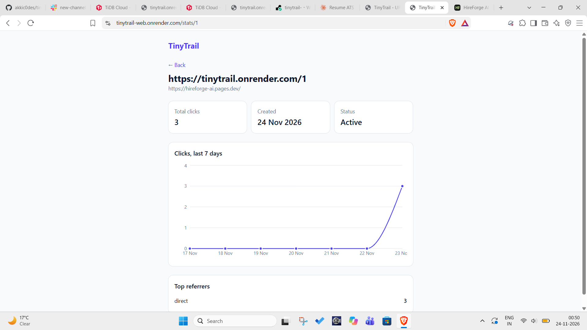

# TinyTrail

A production-style URL shortener: Spring Boot 3 (Java 21) + MySQL + Redis backend, React (Vite) frontend.

**Features:** short links from a Base62-encoded DB ID or a custom alias · expiry · 302 redirects with Redis cache-aside ·
per-IP rate limiting · async click tracking (hashed IPs) · stats + 7-day analytics · QR codes.

**Live demo:** https://tinytrail-web.onrender.com · **API:** https://tinytrail.onrender.com (example short link: https://tinytrail.onrender.com/1)

> Runs on Render's free tier: the first request after ~15 min idle can take 30-60 s while the backend wakes up (the UI shows a "waking up" message).



## Run it locally (Windows / PowerShell, low memory)

Only MySQL and Redis run in Docker (~640 MB cap total); the app and Vite run directly on your machine.

```powershell
docker compose up -d mysql redis
```

```powershell
cd backend
.\mvnw.cmd spring-boot:run        # heap is capped at -Xmx512m via the pom
```

```powershell
cd frontend
copy .env.example .env            # VITE_API_URL=http://localhost:8080
npm install
npm run dev                       # http://localhost:5173
```

Full containerised demo (needs ~1.5 GB free): `docker compose up --build` → UI on http://localhost:3000, API on :8080.

**Cap WSL 2 memory** (Docker Desktop's biggest hidden cost): create `C:\Users\<you>\.wslconfig`, then run `wsl --shutdown` and restart Docker Desktop.

```ini
[wsl2]
memory=3GB
processors=4
swap=2GB
```

## Configuration (environment variables)

| Variable | Default | Purpose |
|---|---|---|
| `DB_URL`, `DB_USER`, `DB_PASSWORD` | local MySQL / `tinytrail` | datasource |
| `REDIS_HOST`, `REDIS_PORT` | `localhost`, `6379` | Redis |
| `BASE_URL` | `http://localhost:8080` | prefix of the returned `shortUrl` |
| `CORS_ORIGIN` | `http://localhost:5173` | allowed browser origin(s), comma-separated |
| `CACHE_ENABLED` | `true` | `false` = every redirect hits MySQL (for benchmarking) |
| `CACHE_TTL` | `24h` | max cache lifetime (also capped at link expiry) |
| `RATE_LIMIT_MAX`, `RATE_LIMIT_WINDOW` | `10`, `60s` | link creations per IP per window |
| `IP_HASH_SALT` | `dev-only-salt` | **set a secret value in production** |
| `FORWARD_HEADERS_STRATEGY` | `none` | `native` only behind a trusted proxy (else IP spoofing bypasses the limiter) |
| `VITE_API_URL` (frontend, build time) | `http://localhost:8080` | API base URL |

## API

| | |
|---|---|
| `POST /api/links` `{url, customAlias?, expiresInDays?}` | 201 + link · 400 invalid · 409 alias taken · 429 + `Retry-After` |
| `GET /{shortCode}` | 302 · 404 unknown · 410 expired/inactive |
| `GET /api/links/{code}/stats` | link info + click count |
| `GET /api/links/{code}/analytics` | clicks per day (7 days), top 5 referrers, total |

Errors are always `{ "status": 409, "message": "...", "timestamp": "..." }`.

## Design decisions (interview notes)

- **Base62 of the auto-increment ID** (`Base62Encoder`): unique by construction, no collision-retry loop, shortest possible codes.
  The row is inserted first (to get its ID), then the code is set in the same transaction. Trade-off: codes are sequential/guessable.
- **Case-sensitive column** (`ascii_bin`): MySQL's default collation is case-insensitive, so `aB` and `ab` would collide on the
  unique index. An integration test guards this.
- **Cache-aside** (`LinkCache`): read Redis → on miss read MySQL and fill Redis. TTL = min(24h, time until expiry), so a cache hit
  never needs an expiry check. `deactivate()` evicts. Redis errors fall back to MySQL instead of failing the redirect.
- **Rate limiting** (`RateLimiter`): `INCR` + `EXPIRE` on first hit, in Redis so it works across instances. Fails open if Redis is down.
  Fixed window (allows a burst at the window edge) – a sliding window would be the next step.
- **Async clicks** (`ClickTrackingService`): `@Async` on a bounded pool (2–4 threads, queue 1000). When the queue is full clicks are
  dropped rather than slowing the redirect. IPs are stored only as a salted SHA-256.
- **Why 302, not 301**: browsers cache 301s forever, which would hide clicks and break expiry/deactivation.

## Tests

```powershell
cd backend
.\mvnw.cmd verify      # unit + Testcontainers integration tests (Docker must be running) + JaCoCo
```

- Unit (JUnit 5 + Mockito): `Base62Encoder`, `LinkService`, `RateLimiter`, `ClickTrackingService`.
- Integration (Testcontainers MySQL 8 + Redis, MockMvc): create → 302, 404, 410, 409, 400s, 11th request → 429, second redirect served
  from cache (repository not called), async click shows up in stats/analytics, only hashed IPs stored.
- Coverage report: `backend/target/site/jacoco/index.html`. The build fails if line coverage of `com.tinytrail.service` drops below 80%.

## Load test (k6)

Install k6 (`winget install k6`), restart the backend with a higher limit (setup creates 100 links), then run:

```powershell
$env:RATE_LIMIT_MAX = "1000"; cd backend; .\mvnw.cmd spring-boot:run     # terminal 1
k6 run load-test\redirect-test.js                                         # terminal 2 (50 VUs, 60 s)
```

Prints `http_req_duration` including **p(95)**; the run fails if p95 ≥ 200 ms. Repeat with `$env:CACHE_ENABLED = "false"`
and compare. Use `-e VUS=100` for more load. Docker alternative: `Get-Content load-test\redirect-test.js | docker run --rm -i grafana/k6 run -e BASE_URL=http://host.docker.internal:8080 -`.

## Deployment

| Piece | Where | Notes |
|---|---|---|
| Frontend | Render **Static Site** | `npm run build` (Vite); `VITE_API_URL` is baked in at build time; rewrite `/*` → `/index.html` for client-side routes |
| Backend | Render **Web Service** (Docker) | Singapore region, Java 21, `JAVA_TOOL_OPTIONS=-Xmx300m` to fit the 512 MB free tier |
| Database | **TiDB Cloud Starter** | MySQL-compatible; TLS via `sslMode=VERIFY_IDENTITY` in the JDBC URL |
| Cache / rate limits | Render **Key Value** (Valkey, Redis-compatible) | Private network only, no public endpoint |

**Backend environment variables** (set in the Render dashboard; never commit values):

| Variable | Description |
|---|---|
| `DB_URL` | JDBC URL of the TiDB database, including `sslMode=VERIFY_IDENTITY` |
| `DB_USER` / `DB_PASSWORD` | TiDB credentials |
| `DB_POOL_SIZE` | Max DB connections; keep small on the free tiers |
| `REDIS_HOST` / `REDIS_PORT` | Internal address of the Key Value instance |
| `JAVA_TOOL_OPTIONS` | JVM flags, e.g. the heap cap for the 512 MB instance |
| `FORWARD_HEADERS_STRATEGY` | Set to `native` so the app trusts Render's proxy headers |
| `IP_HASH_SALT` | Secret salt for hashing client IPs before storing clicks |
| `BASE_URL` | Public backend URL, used to build returned short URLs |
| `CORS_ORIGIN` | Frontend origin allowed to call the API |

**Deployment gotchas**
- Maven Central returned **429** to Render's shared build IPs; the build now uses the Google Maven Central mirror (`backend/.mvn/settings.xml`).
- `CORS_ORIGIN` must match the frontend origin exactly (scheme + host, no trailing slash).
- `FORWARD_HEADERS_STRATEGY=native` is required, otherwise rate limiting sees Render's proxy IP instead of the real client IP.

## Screenshots


*Shorten a link with optional custom alias and expiry; recent links saved locally*


*Per-link analytics: total clicks, 7-day chart and top referrers*

## Benchmark results

_Coming soon (k6, cache on vs off)._

## Known limits (deliberate shortcuts)

- No auth, so there is **no public deactivate/delete endpoint** (`LinkService.deactivate` exists, tested, and evicts the cache).
- Schema is created by Hibernate `ddl-auto=update`; use Flyway migrations for a real production launch.
- Unknown codes aren't negatively cached, so a flood of random codes hits MySQL.
- All clicks on one link update the same row; for extreme traffic batch the counter in Redis.
